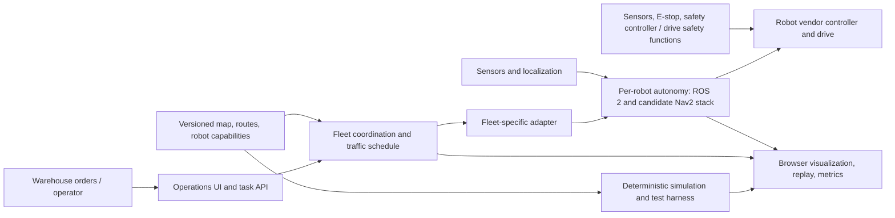

# Warehouse Robotics: Industry Architecture and Roadmap

**Status:** Proposal for discussion. This document describes a path from the current educational simulator toward a well-engineered warehouse robotics software platform. It is not a safety case, certification claim, compliance assessment, or authorization to operate a robot around people.

## Recommendation

Keep the current project as a simulation and visualization product while making its simulation core trustworthy, extensible, and testable. Do not connect the current browser UI or A* function directly to physical robot motion. If a ROS 2-based product is the goal, treat Nav2 as a candidate for per-robot navigation and evaluate Open-RMF for fleet-level coordination; neither replaces a machine-specific safety system. Nav2 separates navigation into middleware/lifecycle, task orchestration, navigation servers, state estimation, and environmental representation [1]. Open-RMF provides coordination and interoperability concepts for fleets and facility infrastructure [2] [3].

The immediate build should be **Phase 1, simulation foundation**, after a short Phase 0 decision gate confirms the intended product, robot/fleet assumptions, and safety boundary. This preserves the working demo while creating a reliable base for later multi-robot and ROS integration.

## What the repository contains today

The repository at the reviewed `main` revision (`0ab05fc`) contains a Python command-line simulator and a React/TypeScript browser visualizer. Both implement time-aware A* on a 24 × 14 grid, with three fixed shelf blocks, one planned robot, and two or three other agents represented by perfectly repeating, hand-authored cell routes. The planner allows cardinal moves and waiting, rejects same-cell and head-on edge-swap conflicts, and checks that the destination remains free for one full combined obstacle-route cycle. Scenario metadata and routes are shared through `scenarios.json`.

The UI is a local visualization with playback and scenario controls; it has no backend, robot connection, sensor input, localization, mission service, or fleet-management interface. The model has no physical units, vehicle footprint, turning or acceleration limits, braking distance, uncertain obstacle motion, clock synchronization, stale observations, communication failures, doors, charging, or shared-resource reservations. The obstacles are scripted trajectories, not live tracks. These are appropriate simplifications for a teaching demo, but they are not evidence of operational robot safety or production fleet behavior.

The current CI checks Python unit tests and both CLI scenarios, plus TypeScript tests, lint, and a production UI build. Those checks passed on this checkout during this review. They validate the implemented grid model; they do not validate a physical system.

## Proposed target architecture

Separate the user-facing simulator from robot execution. A useful target boundary is:

The diagram is conceptual, not a validated safety design. The simulator should exercise the same versioned map, mission, robot-capability, and fleet-integration contracts where practical, while using mock robot adapters by default. The browser UI should remain an operator/analysis surface, not a direct motor-control path.

**World and scenario model.** Replace assumptions hidden in constants with a versioned, validated model for site maps, coordinate frames, traversable lanes, keep-out areas, shared resources, stations, robot footprints, and capabilities. State the units and time basis for every field. Keep scenario input separate from simulation state and presentation.

**Simulation and planning.** Give simulation an explicit clock, deterministic stepping, event log, replay, and seeded disturbance models. Make the model state clearly what it does and does not represent. A discrete planner can remain useful for route-level experiments, but a later robot simulation must model the selected vehicle's geometry and motion constraints rather than treating one grid cell as a real robot.

**Mission and fleet coordination.** Represent tasks, robot status, route intents, resource reservations, delays, and task completion as explicit contracts. A fleet layer must resolve conflicts between intended routes and shared resources, detect blocked or stale participants, and produce a defined stop/degraded outcome when coordination is unavailable. Open-RMF's traffic schedule is a future-looking record of intended itineraries; its fleet adapters bridge fleet-specific APIs to scheduling and facility interfaces, and its negotiation model handles conflicts that still arise [3]. This is materially different from avoiding scripted moving obstacles in one A* search.

**Per-robot autonomy.** If ROS 2 is selected, use a robot-specific integration boundary for localization, mapping/costmaps, global and local planning, control, recovery, and lifecycle management. Nav2 documents these as separate navigation concepts and servers [1] [4]. A fleet coordinator should issue tasks or destinations through a defined adapter; it should not assume the browser or central scheduler can safely drive a robot's motors.

**Operations, security, and observability.** Add authenticated operator roles, auditable task and configuration changes, health and stale-data indicators, structured logs, metrics, and controlled configuration rollout before any multi-user deployment. ROS 2 provides DDS-Security mechanisms for participant authentication, access policies, and protected communication, but the ROS 2 Jazzy guide says security is off by default and must be configured and enabled deliberately [5]. Security design therefore needs explicit identity provisioning, least-privilege topic access, key lifecycle, and a tested fail-closed deployment policy.

## Safety boundary

The existing planner and any future non-safety-rated planning, fleet, web, or general-purpose CPU software must be treated as **non-safety-rated** unless a qualified assessment of the complete system establishes otherwise. “No collision” in this deterministic grid model means only that the chosen path satisfies the model's discrete rules. It does not establish a safe stopping distance, protective separation, safe speed, or collision avoidance in a real warehouse.

Nav2's Collision Monitor can stop or slow a robot using sensor data, but its own documentation explicitly says it does not provide hard real-time safety certification [6]. It must not be presented as a replacement for the robot manufacturer's safety functions, safety-rated sensing, emergency-stop chain, or a properly designed safety controller. The physical safety architecture must be independent of the browser, planner, fleet server, and ordinary network; it must be designed and verified for the selected vehicle and operating environment by competent robotics and machinery-safety professionals.

ISO lists ISO 3691-4:2023 as the published standard for safety requirements and verification for driverless industrial trucks and their systems. ISO also lists it as under revision, with ISO/DIS 3691-4 as a draft successor in development [7] [8]. This roadmap does not claim conformity to either edition. Before any field deployment, confirm the currently applicable edition, jurisdictional requirements, operating-zone assumptions, and project-specific risk assessment with qualified professionals.

## Phased roadmap

### Phase 0 — Define the product and operating boundary

Decide whether the goal is (a) a polished educational/portfolio simulator, (b) a higher-fidelity digital-twin and fleet-planning tool, or (c) eventual control of a named physical robot fleet. Record the user roles, warehouse tasks, target fleet size, site/map assumptions, robot vendor or generic interface, operating country, and what must happen during a fault. No hardware integration begins in this phase.

**Exit criteria:** a short requirements note names the intended product, non-goals, target platform and operating context, critical hazards for professional review, and the functions explicitly excluded from the software safety boundary. The chosen outcome determines whether ROS 2/Nav2 and Open-RMF are appropriate, rather than adopting them by default.

### Phase 1 — Build a dependable simulation foundation (recommended next build)

Separate the simulation domain model from the UI. Add versioned scenario/map validation, explicit simulation time, deterministic seeded runs, a replayable event stream, stable planner and simulator interfaces, and clear units and model assumptions. Resolve the existing Python/TypeScript planner duplication: choose one canonical implementation for shared use, or keep both only with automated differential tests that prove matching results for the same fixtures. Add structured failure states instead of treating every planner failure as an undifferentiated exception.

Expand tests from hand-authored cases to property-based and generated scenarios, including malformed maps, unreachable goals, route conflicts, delays, blocked passages, and deterministic replay. Preserve the current visualizer as a client of simulation results, not as the simulation's source of truth.

**Exit criteria:** every scenario has a validated schema version; invalid coordinates and inconsistent maps fail before planning; replaying a fixed scenario and seed produces the same event sequence and final state; all generated episodes that claim a valid plan satisfy the declared model's collision and path invariants. Add a repeatable benchmark and record p50/p95 planning time for the standard and 64 × 40 fixtures; agree a latency budget from measured baseline before treating it as a release gate. CI passes the complete Python and TypeScript suites, lint, build, schema validation, deterministic replay, and benchmark smoke test.

### Phase 2 — Model multiple robots and shared resources

Move from “other agents are repeating obstacles” to multiple planned participants with routes, time windows, robot capabilities, and reservations for narrow aisles, crossings, doors, lifts, and charging stations as needed by the selected use case. Add explicit delay, obstruction, stale-status, and communication-loss cases. Introduce deadlock detection and a documented resolution policy: reserve, reroute, wait with a timeout, or enter a degraded/stopped state. Do not silently assume a planned itinerary is the robot's actual position.

**Exit criteria:** at the fleet size chosen in Phase 0, a fixed suite of at least 1,000 seeded test episodes has no model-level conflicts among accepted reservations; every injected obstruction or stale participant yields a logged replan, timeout, or safe degraded state; no episode remains indefinitely in an unreported wait; all random runs are reproducible from their seed and scenario version. Report throughput, wait time, deadlocks, and planner latency, not just path length.

### Phase 3 — Add robot-in-the-loop software simulation

Only after a robot or generic robot profile and ROS 2 distribution are chosen, create a software-in-the-loop environment using the selected robot description and simulator. Connect the planner/fleet contracts to a ROS 2 adapter and the per-robot navigation stack. Test localization drift, sensor occlusion, map mismatch, blocked routes, recovery behavior, process restart, and network interruption. A simulator is still not a safety validation of the real vehicle.

**Exit criteria:** a clean setup can launch the selected software stack and at least one robot model reproducibly; commands, status, task completion, and timestamps have documented mappings; injected stale sensor/robot status cannot be interpreted as fresh success; recovery and operator-visible faults are exercised by automated tests. Record the exact ROS distribution, Nav2 release, simulator, robot model, and interface version.

### Phase 4 — Integrate fleet coordination and operator workflows

If multi-robot or mixed-fleet coordination is required, evaluate Open-RMF against the selected robot vendor APIs and facility systems. Build and test a fleet adapter for one simulated fleet before attempting multiple vendors. Define whether the adapter has full control, limited pause/resume control, or read-only status; Open-RMF documents these as distinct integration capabilities, with trade-offs for coordination [3]. Add operator authorization, command audit, alarms, and recovery procedures.

**Exit criteria:** at least two simulated fleet participants share a traffic schedule; route conflicts trigger negotiation or a documented stop/degraded response; delayed, unavailable, or read-only participants are represented honestly; task state and robot state discrepancies are surfaced rather than hidden; adapter and schedule failures are covered by repeatable integration tests.

### Phase 5 — Controlled hardware pilot readiness (separate safety project)

Do not start this phase merely because simulation gates pass. Select the physical vehicle, sensors, controller, safety-rated equipment, facility and operating conditions. Complete a professional hazard/risk assessment, verify the complete safety-related control system, plan commissioning with restricted access and trained staff, and agree rollback and incident procedures. Review applicable standards and regulations with qualified experts; keep evidence and configuration under change control.

**Exit criteria:** set by the responsible safety and engineering authorities for the actual machine, installation, use case, and jurisdiction. Software test results alone cannot satisfy this gate. No claim of certification or conformity is made by completing this repository roadmap.

## Decisions needed before implementation

1. What are we building first: an educational simulator, a warehouse digital twin, or a path toward a real robot deployment?
2. Is there a target robot, vendor API, robot footprint, or ROS 2 distribution? If none, should the next phase remain strictly hardware-agnostic?
3. What matters first: better single-robot motion modeling, multiple-robot scheduling, warehouse tasks, or visual/operational tooling? What fleet size is the first target?
4. Which country/site and operating conditions should constrain later safety and compliance work? A qualified safety engineer should confirm the applicable requirements.
5. Should the existing Python and TypeScript planners be consolidated, or should both remain with parity tests?
6. Is Open-RMF a desired integration target or only an architecture reference to evaluate later?

Until these are answered, the safest productive scope is Phase 1: make the simulator's model, contracts, replay, and tests robust without exposing any physical robot-control path.

## References

[1]: https://docs.nav2.org/getting_started/navigation_concepts/index.html "Nav2 Navigation Concepts"
[2]: https://www.open-rmf.org/ "Open-RMF: A Common Language for Robot Interoperability"
[3]: https://osrf.github.io/ros2multirobotbook/rmf-core.html "Programming Multiple Robots with ROS 2: RMF Core Overview"
[4]: https://docs.nav2.org/ "Nav2 Documentation"
[5]: https://docs.ros.org/en/jazzy/Concepts/Intermediate/About-Security.html "ROS 2 Jazzy: Security"
[6]: https://docs.nav2.org/configuration/packages/collision_monitor/configuring-collision-monitor-node.html "Nav2 Collision Monitor"
[7]: https://www.iso.org/standard/83545.html "ISO 3691-4:2023 — Driverless Industrial Trucks and Their Systems"
[8]: https://www.iso.org/standard/88615.html "ISO/DIS 3691-4 — Draft Successor"
