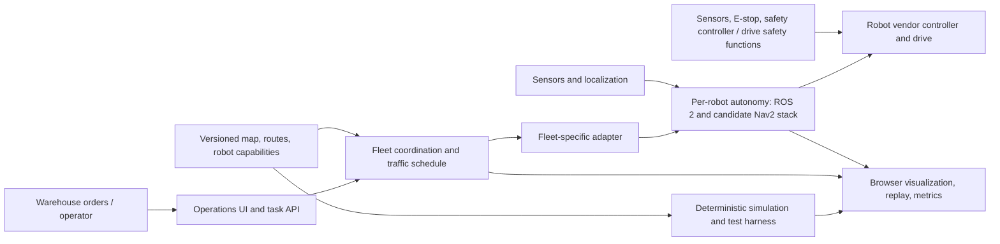

# Warehouse Robotics: Industry Architecture and Roadmap

**Status:** Proposal for discussion. This document describes a path from the current educational simulator toward a well-engineered warehouse robotics software platform. It is not a safety case, certification claim, compliance assessment, or authorization to operate a robot around people.

## Recommendation

Keep the project as a simulation and visualization product while making its simulation core trustworthy, extensible, and testable. Continue using the selected Clearpath Husky A300, ROS 2 Jazzy, Gazebo Harmonic, Nav2, and Open-RMF stack for simulation-only integration. Do not connect the browser UI or A* function directly to physical robot motion; Nav2 and Open-RMF provide useful non-safety navigation and fleet-coordination capabilities, not a replacement for machine-specific safety functions [1] [2] [3].

The near-term focus is to keep hardening the simulation and fleet reliability gates while maintaining the explicitly simulation-only target stack: Clearpath Husky A300, ROS 2 Jazzy, Gazebo Harmonic, Nav2, and Open-RMF. Several foundations from Phases 2–4 are now implemented in simulation; the phases below remain capability goals, not evidence that their exit criteria or any physical safety requirements have been met.

## What the repository contains today

The repository combines a Python warehouse-planning CLI and React/TypeScript visualization with a ROS 2 Jazzy workspace that runs two simulated Clearpath Husky A300 robots in Gazebo Harmonic. Each robot uses Nav2; an Open-RMF fleet adapter dispatches tasks and coordinates itineraries across the shared traffic schedule. The browser UI remains a visualization surface, not a robot-control path.

Automated checks include the Python planner and fault-model tests, ROS package tests and workspace builds, Open-RMF asset validation, UI tests/lint/build, and manual headless simulations. The manual fault-injection suite covers a Nav2 blocked-aisle detour, observer-side stale `FleetState` detection, and adapter-level stale-TF and unavailable-Nav2 task-intake disable/recovery paths. Both adapter cases use opt-in test topics while the underlying TF transport or action server remains available; they are readiness-path regressions, not network-outage or physical-robot tests.

The simulation is still non-safety-rated. It does not validate physical braking, safety-rated sensing, real-world localization or dynamics, DDS/network failure behavior, or safe operation around people. Open-RMF task-intake control and Nav2 behavior are software integration evidence only; they do not replace vendor safety functions or a qualified system risk assessment.

## Proposed target architecture

Separate the user-facing simulator from robot execution. A useful target boundary is:

The diagram is conceptual, not a validated safety design. The simulator should exercise the same versioned map, mission, robot-capability, and fleet-integration contracts where practical, while using mock robot adapters by default. The browser UI should remain an operator/analysis surface, not a direct motor-control path.

**World and scenario model.** Replace assumptions hidden in constants with a versioned, validated model for site maps, coordinate frames, traversable lanes, keep-out areas, shared resources, stations, robot footprints, and capabilities. State the units and time basis for every field. Keep scenario input separate from simulation state and presentation.

**Simulation and planning.** Give simulation an explicit clock, deterministic stepping, event log, replay, and seeded disturbance models. Make the model state clearly what it does and does not represent. A discrete planner can remain useful for route-level experiments, but a later robot simulation must model the selected vehicle's geometry and motion constraints rather than treating one grid cell as a real robot.

**Mission and fleet coordination.** Represent tasks, robot status, route intents, resource reservations, delays, and task completion as explicit contracts. A fleet layer must resolve conflicts between intended routes and shared resources, detect blocked or stale participants, and produce a defined stop/degraded outcome when coordination is unavailable. Open-RMF's traffic schedule is a future-looking record of intended itineraries; its fleet adapters bridge fleet-specific APIs to scheduling and facility interfaces, and its negotiation model handles conflicts that still arise [3]. This is materially different from avoiding scripted moving obstacles in one A* search.

**Per-robot autonomy.** If ROS 2 is selected, use a robot-specific integration boundary for localization, mapping/costmaps, global and local planning, control, recovery, and lifecycle management. Nav2 documents these as separate navigation concepts and servers [1] [4]. A fleet coordinator should issue tasks or destinations through a defined adapter; it should not assume the browser or central scheduler can safely drive a robot's motors.

**Operations, security, and observability.** Add authenticated operator roles, auditable task and configuration changes, health and stale-data indicators, structured logs, metrics, and controlled configuration rollout before any multi-user deployment. ROS 2 provides DDS-Security mechanisms for participant authentication, access policies, and protected communication, but the ROS 2 Jazzy guide says security is off by default and must be configured and enabled deliberately [5]. Security design therefore needs explicit identity provisioning, least-privilege topic access, key lifecycle, and a tested fail-closed deployment policy.

## Safety boundary

The existing planner and any future non-safety-rated planning, fleet, web, or general-purpose CPU software must be treated as **non-safety-rated** unless a qualified assessment of the complete system establishes otherwise. “No collision” in this deterministic grid model means only that the chosen path satisfies the model's discrete rules. It does not establish a safe stopping distance, protective separation, safe speed, or collision avoidance in a real warehouse.

Nav2's Collision Monitor can stop or slow a robot using sensor data, but its own documentation explicitly says it does not provide hard real-time safety certification [6]. It must not be presented as a replacement for the robot manufacturer's safety functions, safety-rated sensing, emergency-stop chain, or a properly designed safety controller. The physical safety architecture must be independent of the browser, planner, fleet server, and ordinary network; it must be designed and verified for the selected vehicle and operating environment by competent robotics and machinery-safety professionals.

ISO lists ISO 3691-4:2023 as the published standard for safety requirements and verification for driverless industrial trucks and their systems. ISO also lists it as under revision, with ISO/DIS 3691-4 as a draft successor in development [7] [8]. This roadmap does not claim conformity to either edition. Before any field deployment, confirm the currently applicable edition, jurisdictional requirements, operating-zone assumptions, and project-specific risk assessment with qualified professionals.

## Phased roadmap

### Phase 0 — Define the simulation use case and operating boundary (baseline set)

The current baseline is a simulation and visualization system using Clearpath Husky A300 with ROS 2 Jazzy, Gazebo Harmonic, Nav2, and Open-RMF. Physical operation and hardware integration are explicitly out of scope. Before broadening the simulation, specify which warehouse tasks, map assumptions, robot capabilities, and target fleet size its tests should represent; any future hardware proposal would require a separate safety and engineering project.

**Exit criteria:** document the selected simulation scenarios, fleet scale, non-goals, and software safety boundary. This records the scope for simulation development; it does not approve hardware integration or establish a safety case.

### Phase 1 — Build a dependable simulation foundation (ongoing hardening)

Separate the simulation domain model from the UI. Add versioned scenario/map validation, explicit simulation time, deterministic seeded runs, a replayable event stream, stable planner and simulator interfaces, and clear units and model assumptions. Resolve the existing Python/TypeScript planner duplication: choose one canonical implementation for shared use, or keep both only with automated differential tests that prove matching results for the same fixtures. Add structured failure states instead of treating every planner failure as an undifferentiated exception.

Expand tests from hand-authored cases to property-based and generated scenarios, including malformed maps, unreachable goals, route conflicts, delays, blocked passages, and deterministic replay. Preserve the current visualizer as a client of simulation results, not as the simulation's source of truth.

**Exit criteria:** every scenario has a validated schema version; invalid coordinates and inconsistent maps fail before planning; replaying a fixed scenario and seed produces the same event sequence and final state; all generated episodes that claim a valid plan satisfy the declared model's collision and path invariants. Add a repeatable benchmark and record p50/p95 planning time for the standard and 64 × 40 fixtures; agree a latency budget from measured baseline before treating it as a release gate. CI passes the complete Python and TypeScript suites, lint, build, schema validation, deterministic replay, and benchmark smoke test.

### Phase 2 — Model multiple robots and shared resources

The ROS/Open-RMF baseline already coordinates two simulated A300 participants on a shared traffic schedule, while the grid A* demonstration still represents other agents as repeating obstacles. Extend the relevant simulation layer with explicit tasks, route intents, time windows, robot capabilities, and reservations for narrow aisles or shared resources. Add delay, obstruction, stale-status, and communication-loss scenarios; define deadlock detection and a documented response such as reserve, reroute, wait with a timeout, or enter a degraded state. Do not silently assume a planned itinerary is the robot's actual position.

**Exit criteria:** at the fleet size chosen in Phase 0, a fixed suite of at least 1,000 seeded test episodes has no model-level conflicts among accepted reservations; every injected obstruction or stale participant yields a logged replan, timeout, or safe degraded state; no episode remains indefinitely in an unreported wait; all random runs are reproducible from their seed and scenario version. Report throughput, wait time, deadlocks, and planner latency, not just path length.

### Phase 3 — Add robot-in-the-loop software simulation

The current software-in-the-loop baseline launches two simulated A300 robots with Nav2 in Gazebo Harmonic and connects them to the ROS 2 fleet adapter. Continue testing localization drift, sensor occlusion, map mismatch, blocked routes, recovery behavior, process restart, and network interruption. A simulator is still not a safety validation of the real vehicle.

**Exit criteria:** a clean setup can launch the selected software stack and at least one robot model reproducibly; commands, status, task completion, and timestamps have documented mappings; injected stale sensor/robot status cannot be interpreted as fresh success; recovery and operator-visible faults are exercised by automated tests. Record the exact ROS distribution, Nav2 release, simulator, robot model, and interface version.

### Phase 4 — Integrate fleet coordination and operator workflows

The current Open-RMF adapter coordinates a simulated two-A300 fleet. Harden this integration with route-conflict, delayed-participant, unavailable-robot, and schedule-failure cases before broadening to additional vendors or facility systems. Define whether future integrations need full control, limited pause/resume control, or read-only status; Open-RMF documents these as distinct capabilities with coordination trade-offs [3]. Operator authorization, command audit, alarms, and recovery procedures remain future software requirements, not evidence of physical readiness.

**Exit criteria:** at least two simulated fleet participants share a traffic schedule; route conflicts trigger negotiation or a documented stop/degraded response; delayed, unavailable, or read-only participants are represented honestly; task state and robot state discrepancies are surfaced rather than hidden; adapter and schedule failures are covered by repeatable integration tests.

### Phase 5 — Controlled hardware pilot readiness (separate safety project)

Do not start this phase merely because simulation gates pass. Select the physical vehicle, sensors, controller, safety-rated equipment, facility and operating conditions. Complete a professional hazard/risk assessment, verify the complete safety-related control system, plan commissioning with restricted access and trained staff, and agree rollback and incident procedures. Review applicable standards and regulations with qualified experts; keep evidence and configuration under change control.

**Exit criteria:** set by the responsible safety and engineering authorities for the actual machine, installation, use case, and jurisdiction. Software test results alone cannot satisfy this gate. No claim of certification or conformity is made by completing this repository roadmap.

## Decisions before expanding the simulation scope

1. Which warehouse task types and operating scenarios should the simulation represent first?
2. What fleet size is the initial scaling target, and which robot capabilities should be modeled?
3. Should Python and TypeScript planners be consolidated, or retained with automated differential tests?
4. What map, aisle, station, and shared-resource assumptions should define the next scenario set?
5. If hardware integration is ever proposed, which jurisdiction and operating conditions would require a separate qualified safety and compliance review?

While these details are unresolved, continue improving the current simulation-only baseline and its reproducible tests. Do not infer physical-robot readiness from successful ROS, Nav2, Gazebo, or Open-RMF simulations.

## References

[1]: https://docs.nav2.org/getting_started/navigation_concepts/index.html "Nav2 Navigation Concepts"
[2]: https://www.open-rmf.org/ "Open-RMF: A Common Language for Robot Interoperability"
[3]: https://osrf.github.io/ros2multirobotbook/rmf-core.html "Programming Multiple Robots with ROS 2: RMF Core Overview"
[4]: https://docs.nav2.org/ "Nav2 Documentation"
[5]: https://docs.ros.org/en/jazzy/Concepts/Intermediate/About-Security.html "ROS 2 Jazzy: Security"
[6]: https://docs.nav2.org/configuration/packages/collision_monitor/configuring-collision-monitor-node.html "Nav2 Collision Monitor"
[7]: https://www.iso.org/standard/83545.html "ISO 3691-4:2023 — Driverless Industrial Trucks and Their Systems"
[8]: https://www.iso.org/standard/88615.html "ISO/DIS 3691-4 — Draft Successor"
